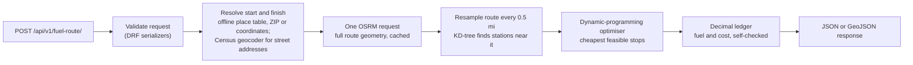

# Fuel Route Planner API


**A Django REST API that plans the cheapest fuel stops for a road trip across the contiguous United States.**
Give it a start and a finish; it returns the driving route (map-ready GeoJSON), the
cost-minimising fuel stops for a vehicle with a **500-mile range** at **10 mpg**, the fuel bought
at each stop, and the **total fuel cost in USD**.

It was built for a backend engineering take-home. The interesting part: the supplied fuel-price
CSV has **no coordinates**, so the project has to place ~6,600 stations on a map without
geocoding them one by one, find the ones near a route, and then solve a constrained optimisation
problem with exact money arithmetic, all with **one routing request per new trip**.

```jsonc
// POST /api/v1/fuel-route/   {"start": "Chicago, IL", "finish": "Dallas, TX"}
{
  "route":   { "distance_miles": 961.5, "geometry": { "type": "LineString", "coordinates": [ … ] } },
  "summary": { "fuel_stops": 2, "fuel_purchased_gallons": 46.37, "total_fuel_cost": 137.23, "currency": "USD" },
  "meta":    { "routing_cache": "miss", "external_calls": { "routing": 1, "geocoding": 0 } }
}
```

*(Abridged; the figures come from a synthetic-data example, see [`docs/examples/`](docs/examples).)*

**Jump to:** [Quick start](#quick-start-windows) · [Try the API](#try-the-api) ·
[Postman](#postman) · [How it works](#how-it-works) · [The optimiser](#the-optimiser) ·
[Tests and performance](#tests-and-performance) · [Limitations](#known-limitations)

**Demo video (4½ min):** [watch on YouTube](https://www.youtube.com/watch?v=frWYPvEN9MQ)

**Live demo:** <https://fuel-planner-api.onrender.com/api/v1/health/>. It runs on **synthetic
data** ([details below](#public-demo-on-render-synthetic-data)); the free tier sleeps when idle, so
the first request can take about a minute.

---

## Contents

1. [What it demonstrates](#what-it-demonstrates)
2. [How it works](#how-it-works)
3. [Tech stack](#tech-stack)
4. [Quick start (Windows)](#quick-start-windows)
5. [Try the API](#try-the-api)
6. [Postman](#postman)
7. [Public demo on Render](#public-demo-on-render-synthetic-data)
8. [API reference](#api-reference)
9. [The optimiser](#the-optimiser)
10. [The dataset](#the-dataset)
11. [Configuration](#configuration)
12. [Tests and performance](#tests-and-performance)
13. [Design decisions and assumptions](#design-decisions-and-assumptions)
14. [Known limitations](#known-limitations)
15. [Project layout](#project-layout)
16. [Troubleshooting](#troubleshooting)
17. [Data sources, attribution and licensing](#data-sources-attribution-and-licensing)

---

## What it demonstrates

* **API design with Django REST Framework.** Strict request validation (unknown keys rejected),
  one consistent JSON error format with stable machine-readable codes, GeoJSON output, rate
  limiting, and a health endpoint.
* **A real optimisation problem.** A dynamic programme chooses stops that minimise cost subject
  to the range limit, detour fuel and starting fuel. It is verified against exhaustive search,
  an independent exact solver and property tests, not just a handful of examples.
* **Geospatial matching without a geocoding service.** Station coordinates are derived offline
  from public-domain U.S. gazetteer data; stations near the route are found with a KD-tree on the
  unit sphere.
* **Careful money handling.** `Decimal` arithmetic, half-up rounding to the cent, a ledger that
  re-simulates every plan and refuses to return one that runs dry, overfills or fails to reconcile.
* **Frugal use of an external service.** One OSRM request per new trip, a cache for repeats,
  collapsing of simultaneous identical requests, throttling, timeouts, and a distinct error for
  every failure mode. The routing provider is replaceable through configuration.
* **Engineering hygiene.** A reproducible setup, environment-based configuration, a test suite
  that needs no network, CI configuration, and an honest account of limitations.

---

## How it works



1. **Validate.** `start`/`finish` may be a city, ZIP code, coordinates or a street address.
2. **Resolve.** Cities and ZIP codes come from a shipped place table, so most requests make no
   geocoding call at all.
3. **Route.** A single OSRM request returns the full road geometry. The result is cached; failures
   are never cached.
4. **Match.** The route is resampled and every station within the detour limit is assigned a
   *route mile* (how far along the route) and an *off-route distance*.
5. **Optimise.** Pick the stops and the amount of fuel to buy at each so the trip is feasible and
   the total cost is minimal.
6. **Account.** Replay the plan leg by leg in `Decimal`, check it is physically valid, and build
   the response.

---

## Tech stack

**Web and API:** Python 3.12+ (developed on 3.13), Django 6.1, Django REST Framework 3.18, SQLite.<br>
**Numerics and geospatial:** NumPy, SciPy (`cKDTree`), haversine geometry, Ramer–Douglas–Peucker route simplification.<br>
**External services:** OSRM (routing), U.S. Census Geocoder (street addresses only), via `requests`.<br>
**Deployment:** gunicorn, Render blueprint (`render.yaml`), environment-driven production settings.<br>
**Quality:** pytest, pytest-django, pytest-cov, `responses` (HTTP mocking), ruff, GitHub Actions workflow.<br>
**Configuration:** environment variables with `python-dotenv`.

---

## Quick start (Windows)

You need **Python 3.12 or newer** (Django 6.1 does not run on 3.11) and Git. No API keys.

```powershell
# 1. Create and activate a virtual environment
py -3.13 -m venv .venv
.\.venv\Scripts\Activate.ps1          # if blocked:  Set-ExecutionPolicy -Scope Process Bypass

# 2. Install dependencies (requirements-dev.txt = runtime + test tools)
pip install -r requirements-dev.txt

# 3. Configure (the defaults work for local development)
copy .env.example .env

# 4. Add the assessment CSV (NOT part of this repository, see "The dataset")
copy "C:\path\to\fuel-prices-for-be-assessment.csv" data\

# 5. Create the database and import the stations
python manage.py migrate
python manage.py load_fuel_data

# 6. Run the server (it loads all data first, so the first request is fast)
python manage.py runserver
```

Open <http://127.0.0.1:8000/api/v1/health/>. It should report `"status": "ok"` with about 6,600
stations. On macOS/Linux use `python3 -m venv .venv`, `source .venv/bin/activate` and `cp`.

Without the CSV the app still starts and the test suite still passes; only the stations (and
therefore trips longer than one tank) are missing.

---

## Try the API

**PowerShell**

```powershell
$body = @{ start = "Chicago, IL"; finish = "Dallas, TX" } | ConvertTo-Json
Invoke-RestMethod -Method Post -Uri http://127.0.0.1:8000/api/v1/fuel-route/ `
  -ContentType "application/json" -Body $body | ConvertTo-Json -Depth 8
```

**curl**

```bash
curl -s -X POST http://127.0.0.1:8000/api/v1/fuel-route/ \
  -H "Content-Type: application/json" \
  -d '{"start": "Chicago, IL", "finish": "Dallas, TX", "options": {"geometry": "none"}}'
```

**On a map.** Add `?format=geojson`, save the output, and drop it on <https://geojson.io>: the
route, start, finish and numbered stops appear. No separate front end is needed because the
response already carries the geometry and the stop coordinates.

---

## Postman

1. In Postman choose **Import** and select
   [`postman/fuel-route.postman_collection.json`](postman/fuel-route.postman_collection.json).
2. The collection variable `base_url` defaults to `http://127.0.0.1:8000`; change it if your
   server runs elsewhere (Collection → Variables).
3. Start the server, then send **Health check** first (it warms the caches).
4. Send the requests in order, or use the Collection Runner.

The collection has 19 requests in 5 folders (health, core trips, location formats, options,
errors). Each request has assertions in its Tests tab. The long-trip request has a **Visualize**
tab that draws the route and stops on a Leaflet map. When last run with Newman against a local
server, all 19 requests and 66 assertions passed (Newman is not a project dependency, and the
run used live OSRM and Census services).

**Suggested demo order:** short trip ($0, no stops) → Chicago → Dallas (2 stops) → New York → Los
Angeles (8 stops; open *Visualize*) → the same request again (`routing_cache: "hit"`, 0 external
calls) → wider detour → half-full start → Seattle → San Diego (the explicit "no feasible plan"
error) → a validation error. With the supplied dataset and live routing, Chicago → Dallas costs
about $134 and New York → Los Angeles about $713 (8 stops, longest leg about 462 miles); small
differences are normal if OpenStreetMap road data changes.

---

## Public demo on Render (synthetic data)

The repository includes a [Render](https://render.com) Blueprint, [`render.yaml`](render.yaml), for
a **public demo that runs on synthetic data only**. The private assessment CSV is never uploaded,
referenced or required.

> **The demo data is synthetic.** Stations are named "DEMO FUEL STOP #n", sit in real towns (from
> the public place table) along a few example routes, and their prices are **invented** by a
> deterministic formula. They are not real stations or real prices. Every API response from the
> demo carries `meta.data_notice` and a first `assumptions` entry saying so, and
> `/api/v1/health/` repeats it. The data lives in
> [`data/demo/synthetic_stations.csv`](data/demo/synthetic_stations.csv) and is produced by
> [`scripts/generate_demo_stations.py`](scripts/generate_demo_stations.py).

**What the blueprint does**

* Runs `pip install -r requirements.txt` (Python 3.13 from [`.python-version`](.python-version)).
* At every start it runs `python manage.py migrate --noinput`, then
  `python manage.py load_demo_data`, then `gunicorn` (one worker, four threads). Both commands
  are idempotent, so repeated starts never duplicate stations, and a fresh filesystem is always
  fully initialised.
* Sets production environment variables: `DJANGO_DEBUG=false`, a **generated**
  `DJANGO_SECRET_KEY` (never stored in the repository), `DJANGO_ALLOWED_HOSTS=.onrender.com`,
  HTTPS redirect, proxy header trust, HSTS, and the `DATA_NOTICE` text. Render's own
  `RENDER_EXTERNAL_HOSTNAME` is added to the allowed hosts and CSRF trusted origins
  automatically; add `DJANGO_CSRF_TRUSTED_ORIGINS` yourself only for a custom domain.
* Uses the health endpoint `/api/v1/health/` as the health check (it is exempt from the HTTPS
  redirect so platform checks over plain HTTP succeed).

**Deploy it (manual steps in the Render dashboard)**

1. Push this repository to GitHub.
2. In Render choose **New → Blueprint**, connect the repository and apply `render.yaml`
   (free plan).
3. Wait for the first deploy, then open `https://<your-service>.onrender.com/api/v1/health/`.
   It should report `"status": "ok"`, 115 stations and the synthetic-data notice.

**Test the live API** (replace the host with your service's URL):

```bash
curl -s https://<your-service>.onrender.com/api/v1/health/
curl -s -X POST https://<your-service>.onrender.com/api/v1/fuel-route/ \
  -H "Content-Type: application/json" \
  -d '{"start": "Chicago, IL", "finish": "Dallas, TX", "options": {"geometry": "none"}}'
```

The Postman collection works unchanged: set its `base_url` variable to the Render URL.
Demo-supported example trips include Chicago → Dallas, New York → Los Angeles, Seattle → San
Diego, Miami → New York, Atlanta → Denver, Minneapolis → Houston and Boston → Chicago.

**Free-tier behaviour and limitations**

* **Ephemeral filesystem.** SQLite lives on the instance's disk and is rebuilt from the committed
  synthetic data at every start, which is safe because the data is read-only demo data. Nothing a
  user does persists, and the database is never a source of truth.
* **Cold starts.** A free web service sleeps when idle; the first request afterwards waits for
  the instance to start, run migrations and load the place table (several seconds).
* **Shared rate limit.** Requests arrive through Render's proxy, so the per-IP rate limiter may
  see many visitors as one client; the blueprint raises the limit to 600/min for that reason.
* **Public OSRM.** The demo calls the free public OSRM server, which is best-effort and limited
  to one request per second; a new trip can occasionally return a 503/504 (repeats are cached,
  but the cache is per process and lost on restart).
* **No paid infrastructure** is used or required. Not verified locally: the `gunicorn` process
  itself (it does not run on Windows) and the Render dashboard steps; they have to be confirmed
  on the first real deploy.

---

## API reference

### `POST /api/v1/fuel-route/`

The trailing slash is optional. Request body:

```json
{
  "start":  "Chicago, IL",
  "finish": "Dallas, TX",
  "options": { "max_detour_miles": 5, "initial_fuel_fraction": 1.0, "geometry": "simplified" }
}
```

**Locations** (`start`, `finish`), any of:

* **City and state:** `"Chicago, IL"`, `"chicago, illinois"`, `"Saint Louis, MO"` (offline, `precision: "city"`)
* **ZIP code:** `"60601"`, `"60601-1234"` (offline, `precision: "zip_centroid"`)
* **Coordinates:** `{"lat": 41.88, "lon": -87.63}` or `"41.88,-87.63"` (`precision: "exact"`)
* **Street address with a house number:** `"233 S Wacker Dr, Chicago, IL 60606"` (one Census
  Geocoder call, then cached; `precision: "address"`)

Only the contiguous United States is supported.

**Options** (all optional; unknown keys are rejected):

| Option | Range / default | Meaning |
|---|---|---|
| `max_detour_miles` | 0.5–25, default 5 | Ignore stations farther than this (straight line) from the route. |
| `initial_fuel_fraction` | 0–1, default 1 | Fuel in the tank at the start, as a fraction of a full tank. |
| `geometry` | `simplified` (default), `full`, `none` | Route geometry detail. |

`?format=geojson` returns a GeoJSON `FeatureCollection` (route, start, finish, numbered stops)
instead of the JSON below.

**Response `200`** (abridged from [`docs/examples/chicago_to_dallas.json`](docs/examples/chicago_to_dallas.json),
which uses synthetic stations):

```jsonc
{
  "start":  { "input": "Chicago, IL", "label": "Chicago, IL", "lat": 41.83705, "lon": -87.68494,
              "resolved_by": "gazetteer_city", "precision": "city" },
  "finish": { "...": "same shape" },
  "route": {
    "distance_miles": 961.5, "duration_hours": 17.04,
    "geometry_mode": "simplified", "geometry_points": 452,
    "geometry": { "type": "LineString", "coordinates": [[-87.68494, 41.83705], "..."] }   // [lon, lat]
  },
  "vehicle": { "max_range_miles": 500.0, "miles_per_gallon": 10.0, "tank_gallons": 50.0,
               "initial_fuel_gallons": 50.0 },
  "fuel_stops": [
    {
      "sequence": 1,
      "station": { "opis_id": 900002, "name": "EXAMPLE TRAVEL CENTER #2", "address": "I-00, EXIT 0",
                   "city": "Marion", "state": "IL", "lat": 37.734631, "lon": -88.944227,
                   "location_precision": "city", "approximate_location": true },
      "price_per_gallon": 3.019,
      "route_mile": 313.0,                 // distance along the route to the stop
      "off_route_miles": 0.8, "detour_miles": 1.6,
      "distance_from_previous_miles": 313.8,
      "fuel_on_arrival_gallons": 18.62, "gallons_purchased": 30.19,
      "fuel_on_departure_gallons": 48.81,
      "cost": 91.14
    }
  ],
  "legs":    [ { "sequence": 1, "from": "start", "to": "stop 1",
                 "distance_miles": 313.8, "fuel_used_gallons": 31.38 }, "..." ],
  "summary": { "fuel_stops": 2, "route_distance_miles": 961.5, "driving_distance_miles": 963.7,
               "detour_miles": 2.2, "fuel_used_gallons": 96.37, "initial_fuel_gallons": 50.0,
               "fuel_purchased_gallons": 46.37, "fuel_remaining_at_destination_gallons": 0.0,
               "total_fuel_cost": 137.23, "average_price_per_gallon": 2.96, "currency": "USD" },
  "assumptions": [ "…plain-language list of every assumption behind the numbers…" ],
  "meta": { "routing_provider": "osrm", "routing_cache": "miss",
            "external_calls": { "routing": 1, "geocoding": 0 },
            "candidate_stations": 7, "max_detour_miles": 5.0, "elapsed_ms": 31,
            "attribution": "Routing by OSRM … © OpenStreetMap contributors (ODbL) …" }
}
```

**Units and rounding** (display only; arithmetic is exact): miles 1 decimal, gallons 2, price
per gallon 3, money 2 (half-up), coordinates 6 (5 along the route). A stop's `cost` is
gallons × the price exactly as supplied (up to 8 decimals), rounded to the cent;
`total_fuel_cost` is the sum of those lines. Multiplying the *displayed* price and gallons can
therefore differ from `cost` by a cent. Fuel balances: `initial + purchased − used = remaining`.

**Errors.** Every failure has the same shape and a stable `code`. For example, a trip that cannot
be completed (from [`docs/examples/infeasible_trip.json`](docs/examples/infeasible_trip.json)):

```json
{
  "error": {
    "code": "no_feasible_fuel_plan",
    "message": "No feasible fuel plan: the vehicle cannot get past route mile 258. The closest next fuel option is the destination, 993 miles away, but it can drive at most 500 miles from there (500-mile range).",
    "details": {
      "last_reachable_route_mile": 258.0,
      "distance_to_next_option_miles": 993.1,
      "shortfall_miles": 493.1,
      "gap_start": { "route_mile": 258.0, "lat": 44.40246, "lon": -123.06147 },
      "gap_end":   { "route_mile": 1250.7, "lat": 32.8304, "lon": -117.12086 }
    }
  }
}
```

(`details` is shortened here.)

| HTTP | `code` | When |
|---|---|---|
| 400 | `validation_error` | Missing/invalid field, unknown key, bad option (`details` lists them). |
| 400 | `invalid_json` | Body is not valid JSON. |
| 400 | `bad_request` | Rejected before reaching the API (e.g. a `Host` not in `DJANGO_ALLOWED_HOSTS`). |
| 400 | `same_location` | Start and finish are the same place. |
| 422 | `location_not_found` | The text matches no city/ZIP/address. |
| 422 | `location_outside_usa` | Outside the contiguous United States. |
| 422 | `route_not_found` | No driving route between the points. |
| 422 | `no_feasible_fuel_plan` | The destination cannot be reached with the data and range; `details` names the gap. |
| 429 | `rate_limited` | Too many requests (`Retry-After` header). |
| 404 / 405 / 406 / 415 | `not_found`, `method_not_allowed`, `not_acceptable`, `unsupported_media_type` | Wrong URL, method, `Accept` or content type. |
| 500 | `internal_error`, `plan_invariant_violation` | A bug; details are logged, never returned. |
| 502 | `routing_provider_error`, `geocoding_provider_error` | An upstream service answered badly. |
| 503 | `routing_provider_unavailable` | Router down or rate limiting (`Retry-After` when given). |
| 503 | `fuel_data_unavailable`, `location_data_unavailable` | Station table empty / database not ready, or place table missing. |
| 504 | `routing_provider_timeout` | The router did not answer in time. |

### `GET /api/v1/health/`

Returns `200` with `"status": "ok"`, the number of stations and places loaded, the routing
provider and Django version; `503` with a hint if no stations are loaded. It also warms the
caches, so call it before a demo.

---

## The optimiser

**Model.** Driving burns 1 gallon per 10 miles; the tank holds 50 gallons (500 miles). A
candidate station sits at some *route mile* and some distance *off the route*. Visiting it means
driving out and back, and that extra fuel is paid for. Fuel can be bought in any amount, and the
vehicle may arrive empty. The goal is the **minimum total fuel cost** without ever running dry.

**Algorithm.** A dynamic programme over the candidate stations in route order. Two facts shrink
the search:

1. *Stopping without buying never helps*: skipping a station never lengthens the trip.
2. *Between two buying stops, an optimal plan either fills the tank or buys just enough to
   arrive at the next stop empty.* Otherwise purchases can be shifted toward the cheaper station
   without raising the cost.

So fuel on arrival is one of three values: empty, "full tank minus the leg", or "starting fuel
minus the leg". The DP keeps the cheapest way to reach each station in each state and tries both
moves from each. It runs in roughly O(n·m·log m) for n candidates with m inside one tank range.
Ties go to the plan with fewer stops, then to the lowest station ID, so results are deterministic.

**Worked example** (a unit test): a 1,100-mile route, full tank at the start.

| Station | A | B | C | D | E | F |
|---|---|---|---|---|---|---|
| Route mile | 150 | 420 | 480 | 700 | 850 | 980 |
| $/gal | 3.80 | 3.40 | 3.10 | 3.90 | 2.95 | 3.60 |

E is the cheapest, but at mile 850 it is beyond the first tank, so it cannot be a first stop. A
and B are skipped because C is cheaper and reachable. At C (mile 480) 2 gallons remain; E is
cheaper and 370 miles on, so the plan buys *just enough* to get there: 35 gal × $3.10 = **$108.50**.
At E the tank is empty and the destination is 250 miles away: 25 gal × $2.95 = **$73.75**.
Total **$182.25**, two stops. "Cheapest station" or "fill up whenever low" strategies do worse here.

**Verification.** The optimiser is exact for the model above, and the repository's tests check it:

* it matches an exhaustive search over every subset of stops on 960 random small instances;
* it matches a second, independently written exact solver on 190 realistic instances (up to 96
  stations, partial tanks, detours), with differences of about 1e-13 dollars;
* 15 property tests, such as "adding a station never raises the cost" and "a bigger tank never
  raises it";
* it never costs more than three common driver strategies on 80 random trips;
* 39 deliberately injected bugs were each caught by the suite.

"Exact" means exact *for the candidate stations given to it and the model's assumptions*:
city-centroid station positions, straight out-and-back detours and a free starting tank. See
[Known limitations](#known-limitations).

---

## The dataset

**The assessment CSV is not included in this repository.** Its redistribution rights are not
established, so `data/*.csv` is git-ignored. Place your copy at
`data/fuel-prices-for-be-assessment.csv` (or set `FUEL_CSV_PATH`). If it is missing, the import
command stops with an explanatory message, and the tests that need it skip themselves.

The file has columns `OPIS Truckstop ID, Truckstop Name, Address, City, State, Rack ID, Retail
Price`. **It has no coordinates.** Addresses are highway-exit descriptions (an interstate, an exit
number and a cross-route), which no ordinary geocoder resolves, and geocoding thousands of stations through a public service would
violate its usage policy and the "few API calls" goal. So stations are located offline:

1. [`data/us_places.csv.gz`](data/us_places.csv.gz) (committed, 3.9 MB, public-domain U.S.
   government data) maps `City, State` → coordinates. It merges the Census Bureau Gazetteer
   (places, county subdivisions, ZIP areas) and USGS GNIS populated places. Rebuild it with
   `python manage.py build_gazetteer`.
2. `python manage.py load_fuel_data` cleans the CSV, places each station at the **centroid of its
   city**, and writes a matching report (`data/import_report.json`, git-ignored).

What the import did with the supplied file:

* 8,151 rows read; 620 Canadian rows excluded; 0 rows rejected as malformed; 26 exact duplicates.
* 6,626 U.S. stations (unique IDs). Where one station's rows disagree on price (487 stations),
  the **lowest** price is kept.
* **6,614 stations located (99.82 %).** The other 12 are excluded and listed in the report, never
  guessed.

The import is re-runnable (it replaces the table in one transaction; `--dry-run` only analyses).
Restart the server after re-importing. Malformed rows (for example an unquoted decimal comma) are
rejected rather than repaired, and prices keep all of their up to 8 decimals.

**How accurate are station positions?** A city centroid is not the pump. On the 189 stations
whose address names I-80, along a New York → Los Angeles route, the median distance from the
centroid to the actual road was 1.6 miles (90 % within 4.5 miles). Every station in a response is
labelled `"location_precision": "city"` and `"approximate_location": true`.

---

## Configuration

Settings come from environment variables, optionally loaded from a git-ignored `.env`
(copy [`.env.example`](.env.example)). Nothing secret is stored in the repository.

<details>
<summary><strong>All variables</strong></summary>

| Variable | Default | Meaning |
|---|---|---|
| `DJANGO_DEBUG` | `false` | `true` for local development (allows the built-in development secret key). |
| `DJANGO_SECRET_KEY` | – | **Required when `DJANGO_DEBUG` is false**; the app refuses to start without it. |
| `DJANGO_ALLOWED_HOSTS` | `localhost,127.0.0.1,[::1],testserver` | Comma-separated host names. |
| `FUEL_CSV_PATH` | `data/fuel-prices-for-be-assessment.csv` | Where the assessment CSV is. |
| `GAZETTEER_PATH` | `data/us_places.csv.gz` | Place-name → coordinates table (shipped). |
| `ROUTING_PROVIDER` | `osrm` | `osrm`, or a dotted path to your own `RoutingProvider` class. |
| `OSRM_BASE_URL` | `https://router.project-osrm.org` | Point at a self-hosted OSRM for real traffic. |
| `OSRM_PROFILE` | `driving` | OSRM profile. |
| `OSRM_TIMEOUT_SECONDS` | `15` | Timeout for the routing request. |
| `OSRM_MIN_INTERVAL_SECONDS` | `1.0` | Minimum gap between outgoing routing requests (public server limit). |
| `HTTP_USER_AGENT` | `spotter-fuel-route-assessment/1.0 …` | Identifies you to OSRM and the Census geocoder (their policies require it); add your contact address. |
| `CENSUS_GEOCODER_URL` | Census `onelineaddress` endpoint | Street-address geocoder (only used for addresses). |
| `CENSUS_TIMEOUT_SECONDS` | `10` | Timeout for an address look-up. |
| `ROUTE_CACHE_SECONDS` / `GEOCODE_CACHE_SECONDS` | 1 day / 30 days | Cache lifetimes. |
| `CACHE_MAX_ENTRIES` | `200` | Cap on the in-process cache (a coast-to-coast route is about 0.5 MB). |
| `THROTTLE_RATE` | `120/min` | API rate limit per client IP. |
| `LOG_LEVEL` | `INFO` | Logging level of the `fuelplanner` logger. |
| `DATABASE_FILE` | `db.sqlite3` | SQLite file name. |
| `DATA_NOTICE` | empty | Non-empty on synthetic-data deployments: added to every response and the health check. |
| `DJANGO_CSRF_TRUSTED_ORIGINS` | empty | Extra trusted origins (Render's host is added automatically). |
| `DJANGO_SECURE_SSL_REDIRECT` | `false` | Redirect HTTP to HTTPS (deployment behind TLS). |
| `DJANGO_SECURE_HSTS_SECONDS` | `0` | HSTS max-age; see also `DJANGO_SECURE_HSTS_INCLUDE_SUBDOMAINS` and `DJANGO_SECURE_HSTS_PRELOAD` (both `false`). |
| `DJANGO_BEHIND_HTTPS_PROXY` | `false` | Trust `X-Forwarded-Proto: https` from a TLS-terminating proxy. |

</details>

**Production notes.** Set `DJANGO_DEBUG=false`, a real `DJANGO_SECRET_KEY` and
`DJANGO_ALLOWED_HOSTS`, and the HTTPS settings above (with all of them on,
`python manage.py check --deploy` reports no issues; the CSRF check is deliberately silenced
because the API uses no cookies or sessions). Run behind a real WSGI server
(`config.wsgi.application`), use a shared cache (Redis/Memcached) if you run several processes,
and use your own OSRM server instead of the public demo.

---

## Tests and performance

```powershell
pytest                                   # 495 tests, no network access needed (about 1 min)
pytest --cov --cov-fail-under=95         # with coverage: about 99.4 % of lines
pytest -m live                           # 2 smoke tests against the real OSRM / Census services
ruff check . ; ruff format --check .     # lint and formatting
```

* **No network and no private data needed.** On a fresh clone 485 tests run and 10 skip themselves
  because they need the git-ignored CSV (they pass when it is present). Every external service is
  mocked; the 2 `live` tests are excluded by default.
* **What is covered:** the optimiser (exhaustive and reference-solver comparison, properties,
  boundaries, infeasible routes), fuel and cost arithmetic, station matching and geometry,
  location resolution, the OSRM client (every failure mode, throttling, caching, collapsing of
  concurrent requests), the API contract and every error response, the importer on messy files,
  randomised whole-pipeline invariants, golden tests on the real dataset using recorded routes,
  concurrency, and performance budgets.
* **CI.** [`.github/workflows/ci.yml`](.github/workflows/ci.yml) runs lint, Django checks,
  migration check and the suite with a coverage gate. The steps were run locally from a clean
  clone; this README does not claim a particular CI result.

### Performance

Measured on one Windows laptop (Python 3.13, development server). Timings vary by machine.

*Offline and reproducible* (router mocked; the tests assert generous budgets):

* Optimiser: about 9 ms for 176 candidates over 2,810 miles; about 74 ms for 600 candidates over 6,000 miles.
* A coast-to-coast request on the real dataset, from route geometry to response: about 25–30 ms.
* Start-up warm-up (place table + stations): about 0.8 s, once.
* Response size, New York → Los Angeles: about 49 KB (75 KB with `geometry: full`, 6 KB with `none`).

*Network-dependent* (live public OSRM, one sample run; not reproducible to the millisecond):

* A new New York → Los Angeles trip: about 0.9 s, almost all of it waiting for OSRM.
* The same trip repeated (cache hit, zero external calls): about 30–40 ms.

Every response reports `meta.external_calls` and `meta.elapsed_ms`, so the claim is checkable on
any request: a new trip makes exactly **one** routing request (plus one geocoding request only
for a street address); an identical repeat makes **none**.

---

## Design decisions and assumptions

* **Starting fuel.** The vehicle starts with a full tank (adjustable via `initial_fuel_fraction`)
  and that fuel is *not* counted as a purchase, since the brief does not say otherwise. Any trip
  within 500 miles therefore costs **$0.00**, and the response says so in `assumptions`.
* **Prices.** Each station uses the lowest price listed for it, treated as the current USD price
  per gallon. The CSV has no fuel type, opening hours or timestamps.
* **Routing.** OSRM, because it is free, needs no key, and returns the whole geometry in one
  request. Identical journeys are cached and simultaneous identical requests are collapsed into
  one.
* **No per-station geocoding.** See [The dataset](#the-dataset).
* **Detours.** Stations within `max_detour_miles` (straight line) of the route are considered,
  and the out-and-back trip is charged as driven miles and fuel. This is conservative: a real exit
  ramp is usually shorter.
* **Honesty over plausibility.** Unlocated stations are left out, malformed rows are rejected
  rather than repaired, and an impossible trip returns an explicit error with the gap, never a
  made-up plan.

---

## Known limitations

* **Station positions are city-level**, typically within a few miles. A station can be missed or
  wrongly included near the corridor edge; use a larger `max_detour_miles` to be safe.
* **Coverage gaps change the answer.** The data has only a few dozen stations in California and
  Oregon combined, so some West Coast trips (for example Seattle → San Diego) are genuinely
  infeasible with a 500-mile range; the error says where.
* **The public OSRM server is best-effort,** limited to one request per second, and not meant for
  production traffic. Cold requests take about a second, mostly waiting for it. Use your own OSRM
  for real use.
* **Coordinates close to the border** (for example in Canada) can be accepted, because the check
  is a bounding box plus "near a known U.S. place", not a true border test. City, ZIP and address
  inputs always resolve inside the U.S.
* **Contiguous U.S. only;** no Alaska, Hawaii or territories.
* **No traffic, tolls, truck restrictions or opening hours.** Durations are OSRM's free-flow
  estimates and prices are a snapshot.
* **Single-process cache.** The default cache lives in memory; use Redis/Memcached with several
  workers, and restart after re-importing stations.
* **Range and mpg are fixed at 500 / 10** by the brief (configurable in settings, not per request).

---

## Project layout

```
config/                 Django project (settings, urls, wsgi; settings_test.py for the tests)
fuelplanner/
  api/                  views, serializers, response builder, error handling, urls
  services/
    locations.py        text / ZIP / coordinates / address  ->  coordinates
    geocoding.py        Census Geocoder client (street addresses only)
    routing.py          OSRM client, throttle, cache, replaceable provider
    geometry.py         distances, resampling, route simplification
    stations.py         station index and route-corridor matching
    optimizer.py        the dynamic programme
    accounting.py       exact fuel and money ledger with self-checks
    planner.py          puts the steps together
    gazetteer.py, text.py, states.py, warmup.py, callcount.py
  importer.py           CSV cleaning and station placement
  management/commands/  build_gazetteer, load_fuel_data, load_demo_data, runserver (warms up first)
  models.py             Station
data/us_places.csv.gz   shipped place table (the CSV itself is git-ignored)
data/demo/               synthetic demo stations (public demo only)
scripts/                generator for the synthetic demo stations
render.yaml             Render blueprint for the synthetic-data public demo
docs/examples/          example responses (synthetic stations)
postman/                Postman collection
tests/                  test suite, fixtures (synthetic data, recorded OSRM routes)
```

---

## Troubleshooting

<details>
<summary><strong>Common problems</strong></summary>

| Symptom | Fix |
|---|---|
| `ImproperlyConfigured: DJANGO_SECRET_KEY is not set` | `copy .env.example .env` (or set `DJANGO_DEBUG=true`). |
| `Fuel price CSV not found` | Put the CSV in `data\` or set `FUEL_CSV_PATH`. |
| Health says `unavailable` / `fuel_data_unavailable` | Run `python manage.py migrate` then `python manage.py load_fuel_data`. |
| `routing_provider_unavailable` / 429 | The public OSRM is busy or rate limiting; wait and retry (repeat requests are cached). |
| `no_feasible_fuel_plan` | Genuine data gap on that route; try a larger `max_detour_miles` or check `details.gap_start`. |
| `You have 1 unapplied migration(s)` after updating | `python manage.py migrate`, then `python manage.py load_fuel_data` again (prices are now stored with all 8 decimals). |
| Activate.ps1 is blocked | `Set-ExecutionPolicy -Scope Process Bypass` in that window. |
| `No matching distribution` for Django 6.1 | You are on Python < 3.12; install Python 3.13. |

</details>

---

## Data sources, attribution and licensing

* **Routing:** [OSRM](https://project-osrm.org/); map data © [OpenStreetMap](https://www.openstreetmap.org/copyright)
  contributors, available under the ODbL. The recorded routes in `tests/fixtures/osrm` come from
  the public OSRM demo server.
* **Place coordinates:** U.S. Census Bureau Gazetteer files and the USGS Geographic Names
  Information System (U.S. government data, public domain).
* **Street-address geocoding:** U.S. Census Bureau Geocoder.
* **Fuel prices:** the OPIS dataset supplied with the assessment, **not redistributed here**.
* **Public demo data:** `data/demo/synthetic_stations.csv` is synthetic (fictional station
  names, invented prices) and unrelated to the assessment dataset; the private CSV is never
  deployed.
* **Example files:** `docs/examples/` uses synthetic, clearly named stations
  ("EXAMPLE TRAVEL CENTER #n") with invented prices, produced by running this code on recorded
  routes. They show the format and the arithmetic, not real stations.
* **Code license:** no open-source license file has been added to this repository.

---

## What this project shows

Taking an ambiguous brief and a data file with a missing key attribute, and turning them into a
working service: choosing and documenting assumptions, solving the geolocation problem without
brute-force API calls, formulating and exactly solving the optimisation, keeping money arithmetic
exact, designing an API with predictable errors, and proving the result with tests that can fail,
including tests built to catch the author's own mistakes.
